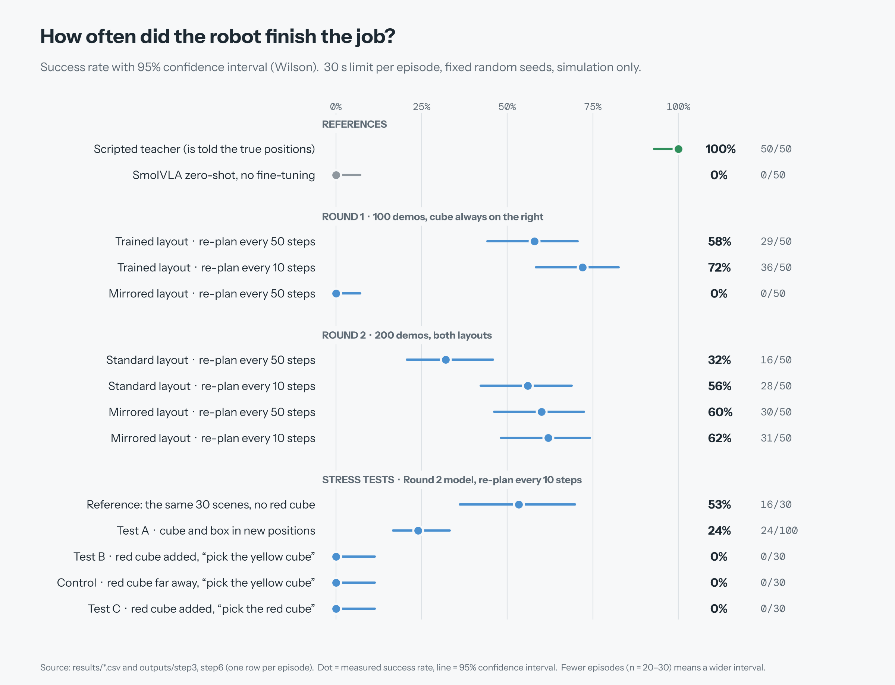
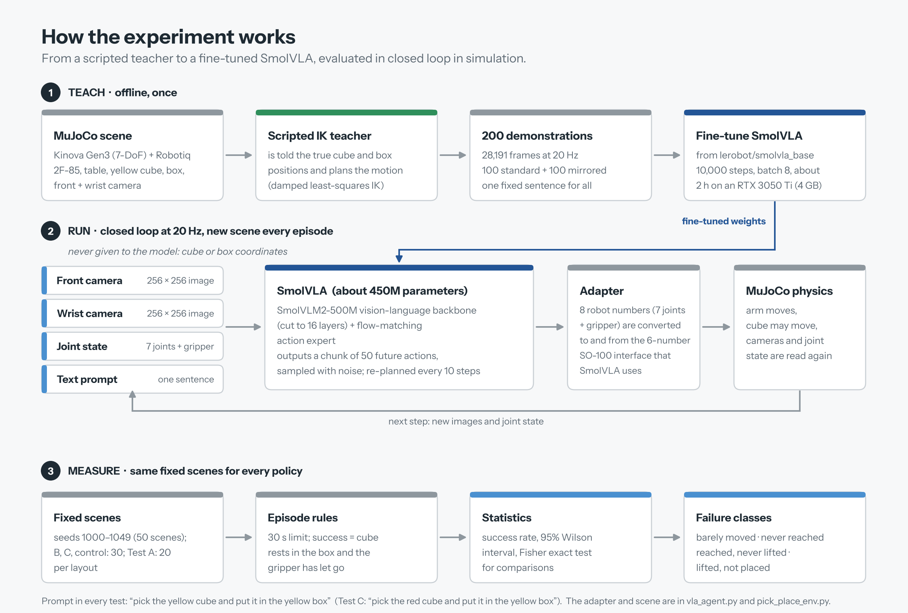
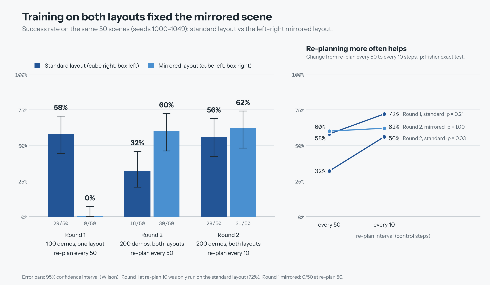
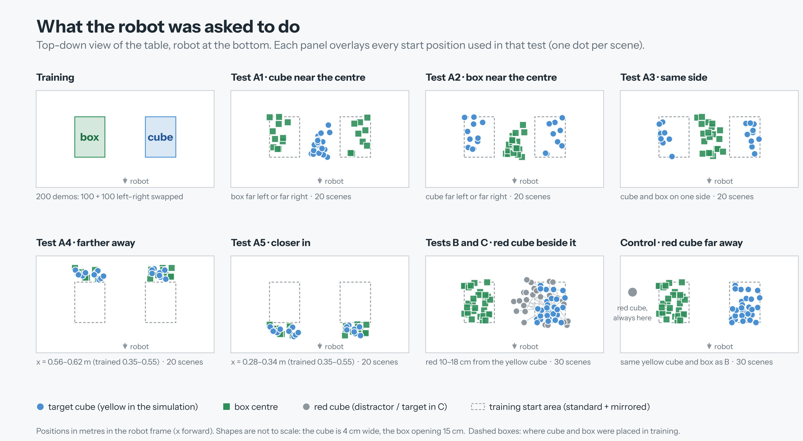
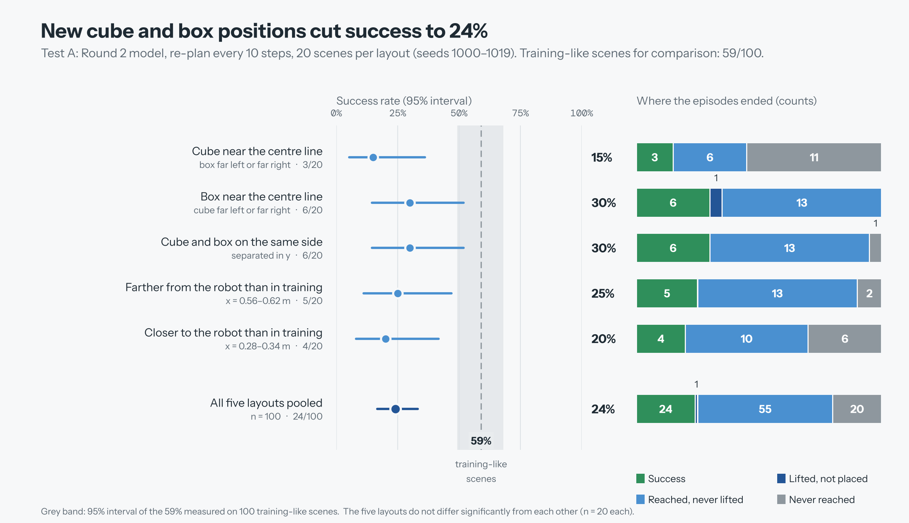
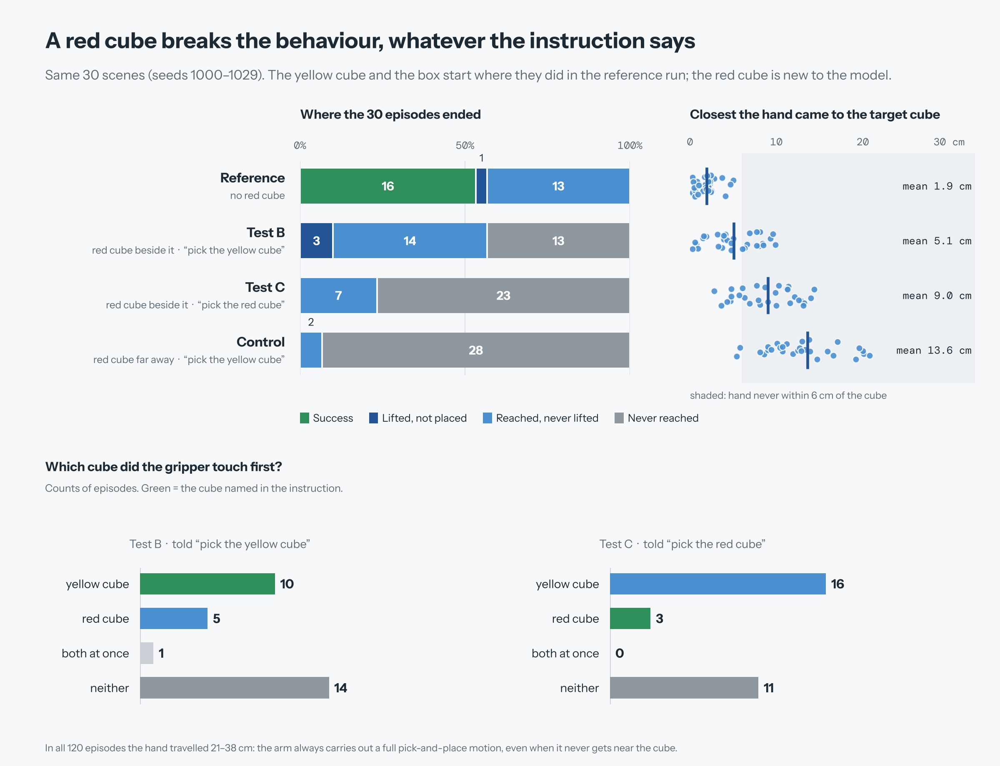
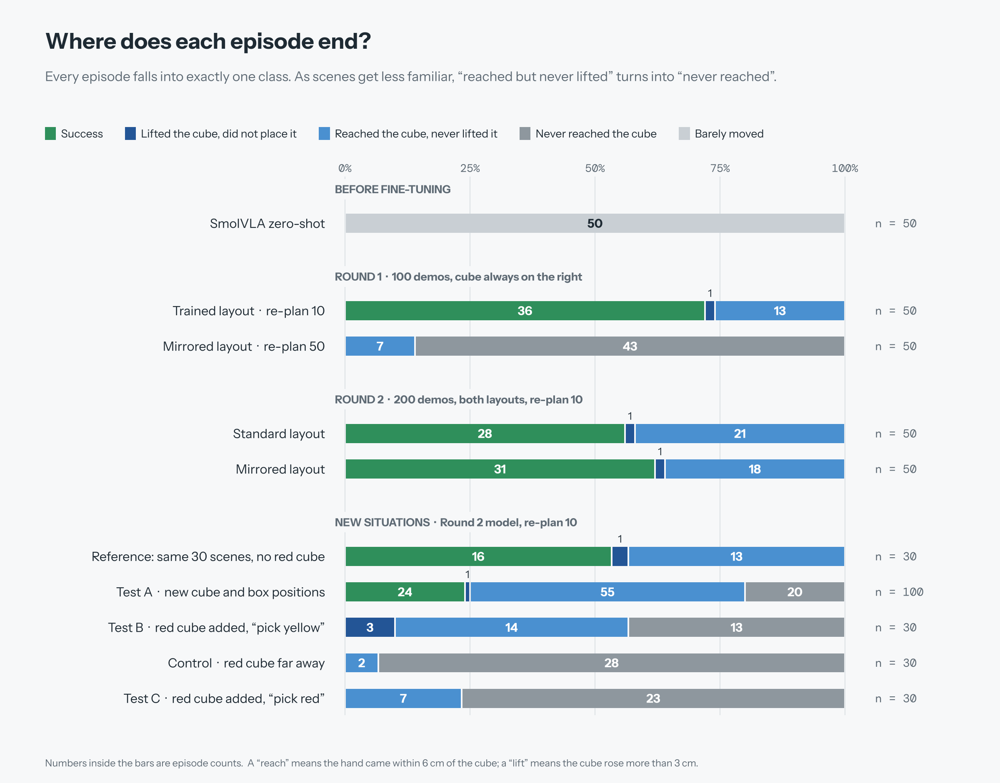
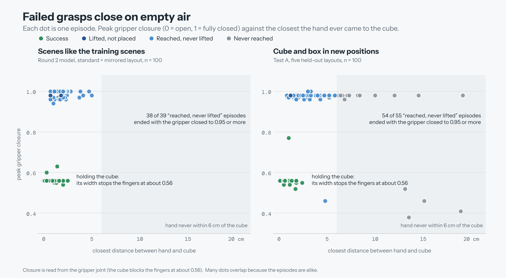

# Language-Guided Pick-and-Place with SmolVLA on a Simulated Kinova Gen3

Can the pretrained vision-language-action model **SmolVLA** (Hugging Face / LeRobot, `lerobot/smolvla_base`, about 450M parameters)
follow *"pick the yellow cube and put it in the yellow box"* on a simulated Kinova Gen3 arm, and what does it actually learn
when it is fine-tuned on a few hundred scripted demonstrations?
**Simulation only (MuJoCo), no real robot.** Metrics: success rate with confidence intervals, completion time and failure analysis.

## Summary

- **Out of the box SmolVLA does nothing useful:** 0/50 successes, the arm barely moves.
- **Fine-tuning on scripted demonstrations works on scenes like the training scenes:** 32-72% success depending on the round and the re-plan setting, 56-72% at the final setting (50 scenes per test), against 100% for the scripted teacher. This is the success rate on scenes that look like the training scenes; it is not a general ability.
- **Training on both left-right layouts fixed the mirrored scene:** 0/50 (Round 1) became 30-31/50 (Round 2).
- **It does not transfer to new situations:** with cube and box in new positions success falls to **24%** (24/100); with a **red cube** added to the table it is **0/30** whichever cube the instruction names, and also 0/30 when the red cube is far away from everything.
- **Most failures happen at the grasp, not on the way to the cube:** the arm gets close to the cube and then closes the gripper on empty air (54 of 55 "reached but never lifted" failures in Test A), and it almost never tries again. With new positions or a new object, a growing share of episodes never reach the cube at all.
- **We found no evidence that the colour word in the sentence steers the model.** All 200 demonstrations used one sentence in one scene, so the language was never needed to solve the task during fine-tuning. This is a statement about this training setup, not about SmolVLA in general.



## 1. What we did



**Scene and robot.** MuJoCo 3.16: Kinova Gen3 (7-DoF) with a Robotiq 2F-85 gripper, a table, a 4 cm yellow cube (random yaw up to 45 degrees),
a box with a 15 cm opening, a front camera and a wrist camera (256 x 256 pixels), control at 20 Hz. Robot models come from MuJoCo Menagerie.

**Interface to SmolVLA.** SmolVLA expects the 6-number state/action of an SO-100 arm. `Gen3ToSO100Adapter` (`vla_agent.py`) converts the 8 robot numbers
(7 joints + gripper) to that format and back. SmolVLA predicts a chunk of 50 actions; the setting `SMOLVLA_REPLAN` decides after how many steps the chunk is
thrown away and a new one is predicted (50 = default, 10 = used in Tests A, B, C and the control). SmolVLA samples its actions with random noise, so the same scene can end differently when it is run again.

**Autonomy.** At test time the model receives only the two camera images, the joint state and the sentence. Cube and box coordinates are never given to it.
The scripted teacher (`expert_controller.py`, damped-least-squares inverse kinematics) *is* told the true positions, but it is used only to record demonstrations and as an upper-bound reference.

**Demonstrations and fine-tuning.**

| | Round 1 | Round 2 |
|---|---|---|
| Demonstrations | 100 (14,036 frames) | 200 (28,191 frames) |
| Layout | cube always on the robot's right (x 0.35-0.55 m, y -0.25 to -0.10 m), box on the left (y 0.12 to 0.25 m) | the same, and every second episode mirrored (cube left, box right) |
| Sentence | one: "pick the yellow cube and put it in the yellow box" | the same |
| Training | 10,000 steps, batch 8, learning rate 1e-4, about 2 h on an RTX 3050 Ti Laptop (4 GB) | the same |
| Passes over the data | about 5.7 | about 2.8 |

Demonstration seeds (5000+) never overlap with evaluation seeds (1000+). Each round was trained once; training-run variance was not measured.

**Evaluation.** Every policy is run on the same fixed scenes (seeds 1000-1049 for the main tests), 30 s of simulated time per episode.
*Success* means the target cube rests in the box and the gripper has let go of it. Confidence intervals are Wilson 95% intervals, comparisons use Fisher's exact test.
Each failed episode is put into one class: *barely moved*, *never reached the cube* (hand never within 6 cm), *reached but never lifted it* (cube never rose 3 cm),
*lifted but did not put it in the box*. Extra diagnostics: peak gripper closure, closest hand-to-cube distance, grasp attempts (a close command within 8 cm of the cube),
placement error, and which cube the gripper touched first. Completion times are simulated time and exclude model latency (0.46-0.71 s per action chunk on this GPU).

## 2. Results

### 2.1 Overview

All rows: 30 s limit, fixed seeds, same prompt. Mean time = successful episodes only.

| Experiment | Scenes | Success (95% CI) | Mean time |
|---|---|---|---|
| Scripted teacher (upper bound) | 50 | 50/50 = 100% (92.9-100%) | 6.77 s |
| SmolVLA zero-shot | 50 | 0/50 = 0% (0-7.1%), barely moved in 50/50 | n/a |
| Round 1, standard layout, re-plan 50 | 50 | 29/50 = 58% (44.2-70.6%) | 6.64 s |
| Round 1, standard layout, re-plan 10 | 50 | 36/50 = 72% (58.3-82.5%) | 7.85 s |
| Round 1, **mirrored** layout, re-plan 50 | 50 | 0/50 = 0% (0-7.1%) | n/a |
| Round 2, standard layout, re-plan 50 | 50 | 16/50 = 32% (20.8-45.8%) | 6.68 s |
| Round 2, standard layout, re-plan 10 | 50 | 28/50 = 56% (42.3-68.8%) | 7.56 s |
| Round 2, mirrored layout, re-plan 50 | 50 | 30/50 = 60% (46.2-72.4%) | 6.74 s |
| Round 2, mirrored layout, re-plan 10 | 50 | 31/50 = 62% (48.2-74.1%) | 6.95 s |
| Round 2, both layouts, re-plan 10 | 100 | 59/100 = 59% (49.2-68.1%) | 7.24 s |
| **Test A**: new cube/box positions (5 layouts), re-plan 10 | 100 | **24/100 = 24% (16.7-33.2%)** | 8.67 s |
| Reference for B/C: first 30 standard scenes, no red cube | 30 | 16/30 = 53% (36.1-69.8%) | 6.69 s |
| **Test B**: red cube added, "pick the yellow cube" | 30 | **0/30 = 0% (0-11.4%)** | n/a |
| **Test C**: red cube added, "pick the red cube" | 30 | **0/30 = 0% (0-11.4%)** | n/a |
| **Control**: red cube far away, "pick the yellow cube" | 30 | **0/30 = 0% (0-11.4%)** | n/a |

Tests A, B, C and the control all use the Round 2 model with re-plan 10.

### 2.2 Fine-tuning, the mirrored layout and Round 2



- **Fine-tuning is the decisive step:** 0/50 to 29/50 (Fisher p = 1e-11).
- **Round 1 only worked for the layout it was trained on.** Mirrored, 0/50: 43 episodes never reached the cube, 7 reached it but never lifted it (the arm went to where the cube usually is).
- **Round 2 (both layouts in the data) fixed this:** mirrored 0/50 to 30/50 at the same re-plan setting (p = 3e-12), standard and mirrored are now equally good (56% vs 62% at re-plan 10, p = 0.69).
- **Re-planning every 10 instead of 50 steps helped in Round 2's standard layout** (32% to 56%, p = 0.026). In the other two pairs the change is not significant (Round 1: 58% to 72%, p = 0.21; Round 2 mirrored: 60% to 62%, p = 1.0).
- **Round 1 vs Round 2 on the standard layout** looks lower in Round 2 (72% to 56% at re-plan 10, p = 0.14; 58% to 32% at re-plan 50, p = 0.015). The same 10,000 steps were spread over twice the variety, which may be the reason, but we did not test it, and each round was trained only once.

### 2.3 Test A: cube and box in positions never used in training



Five layouts, 20 scenes each (seeds 1000-1019). The dashed rectangles show where cube and box started in training.



| Layout | Success (95% CI) | Never reached | Reached, never lifted | Lifted, not placed | Mean time | Grasp attempts per episode |
|---|---|---|---|---|---|---|
| A1 cube near the centre line | 3/20 = 15% (5.2-36.0%) | 11 | 6 | 0 | 8.4 s | 0.35 |
| A2 box near the centre line | 6/20 = 30% (14.5-51.9%) | 0 | 13 | 1 | 7.6 s | 1.05 |
| A3 cube and box on the same side | 6/20 = 30% (14.5-51.9%) | 1 | 13 | 0 | 8.1 s | 1.00 |
| A4 farther from the robot (x 0.56-0.62 m) | 5/20 = 25% (11.2-46.9%) | 2 | 13 | 0 | 10.1 s | 1.00 |
| A5 closer to the robot (x 0.28-0.34 m) | 4/20 = 20% (8.1-41.6%) | 6 | 10 | 0 | 9.5 s | 0.85 |
| **All five** | **24/100 = 24% (16.7-33.2%)** | 20 | 55 | 1 | 8.7 s | 0.85 |

- Success is much lower than the 59/100 on training-like scenes (p = 8e-7). The five layouts are not significantly different from one another (A1 vs the rest: p = 0.39), so with 20 scenes each we cannot rank them.
- **Where the cube starts seems to decide whether the hand gets there.** In A2 and A3 the cube starts in the zones used in training (only the box is somewhere new) and the hand almost always reaches it: "never reached" in 1 of 40 episodes. In A1, A4 and A5 the cube starts somewhere new (centre line, farther, closer) and "never reached" happens in 19 of 60 (11, 2 and 6 of 20; Fisher p = 0.0002). We grouped the layouts after seeing the results, so treat this as an observation, not a tested mechanism. The success rates of the two groups are not significantly different (12/40 vs 12/60, p = 0.34): in A2 and A3 the hand arrives but the grasp still fails.
- Successful placements land 2-3 cm from the box centre (mean 31.8 mm in Test A, 24.3 mm in the 30 reference scenes).
- For comparison, the scripted teacher solved 30/30 scenes in each of the five layouts in our check.

### 2.4 Tests B and C and the control: a red cube on the table

The model never saw a red cube. The yellow cube and the box start exactly where they started in the reference scenes (same seeds); the red cube is added.

- **Test B:** red cube 10-18 cm from the yellow cube, sentence about the **yellow** cube.
- **Test C:** same scenes, sentence about the **red** cube ("pick the red cube and put it in the yellow box").
- **Control:** red cube always at x = 0.50 m, y = 0.40 m (right at the edge of the front camera view), sentence about the yellow cube.



| Test | Success | Never reached | Reached, never lifted | Lifted, not placed | Closest hand-to-target distance (mean) | Grasp attempts per episode | First cube touched (yellow / red / both / none) |
|---|---|---|---|---|---|---|---|
| Reference, no red cube (30 scenes) | 16/30 | 0 | 13 | 1 | 1.9 cm | n/a | n/a |
| B: red beside, "yellow" | 0/30 | 13 | 14 | 3 | 5.1 cm | 0.67 | 10 / 5 / 1 / 14 |
| C: red beside, "red" | 0/30 | 23 | 7 | 0 | 9.0 cm | 0.33 | 16 / 3 / 0 / 11 |
| Control: red far, "yellow" | 0/30 | 28 | 2 | 0 | 13.6 cm | 0.07 | 2 / 0 / 0 / 28 |

(The reference run was made before the grasp-attempt counter was added, so it has no value for that column. In B and C the "target" for the distance column is the cube named in the sentence.)

- B, C and the control are each significantly worse than the reference (0/30 vs 16/30, p = 1.9e-6).
- In B the yellow cube was lifted in 3 episodes (up to 19 cm high) but never ended in the box; the red cube was never lifted (3 cm threshold) and never ended in the box. All 30 scenes failed, whatever the distance between the two cubes (10-18 cm in these scenes).
- **In C the model touched the yellow cube first in 16 episodes and the red cube first in 3.** It lifted the yellow cube in 5 episodes (never the red one) and never put either cube in the box.
- **Colour word:** which cube was touched first (yellow vs red) is not significantly different between B ("yellow") and C ("red"): 10 vs 5 against 16 vs 3, p = 0.42. This is a crude measure (11-14 episodes touched no cube), but there is no evidence that the word steers the model.
- **The control is not a milder version of B.** With the red cube far from everything the model reached the yellow cube even less often (28 of 30 "never reached", against 13 of 30 in B). We do not know why.
- It is not a bug in the test code: the arm state differs by 6e-5 rad between runs with and without the red cube, the yellow cube and box positions are identical, camera images differ only at the red cube (plus a few edge pixels), and the scripted teacher solves these scenes (30/30 with the red cube beside the yellow cube and the sentence about the yellow cube, 29/30 with the red cube as target).

### 2.5 Live viewer check

`watch_tests.py` shows the five situations one after another in the MuJoCo window (3 episodes each, seeds 1000-1002). One run gave: reference 2/3, new positions 2/3, B 0/3, control 0/3, C 0/3. It is a visual check, not a measurement; the tables above are the evidence.

## 3. Analysis

### 3.1 Where the episodes end



- In scenes like the training scenes (Round 2) almost every failure is the same class: **the hand reaches the cube but the cube is never lifted** (39 of 41 failures at re-plan 10).
- As the scene becomes less familiar, the failures shift towards **never reaching the cube**: 0 of 100 in training-like scenes, 20 of 100 in Test A, 13/30 in B, 23/30 in C, 28/30 in the control.
- In all 120 episodes of the reference, B, C and control runs the hand travelled 21-38 cm from its start: the model always makes a reach-sized motion, even when it never comes near the cube.

### 3.2 What a failed grasp looks like



- **The gripper closes on empty air.** With a cube in the gripper the closure stays around 0.56 (the cube's width stops the fingers). In 54 of 55 "reached but never lifted" episodes of Test A (38 of 39 in training-like scenes, all 39 at 0.94 or more) the closure reached 0.95 or more, which means nothing was held.
- **The approach is a few centimetres off.** The smallest hand-to-cube distance is 0.9 cm on average in successful Test A episodes and 3.3 cm in the failed grasps (0.8 cm and 2.0 cm in training-like scenes). The distance is the minimum over the whole episode, not at the moment of closing.
- **There is no recovery.** In Test A the gripper closed near the cube about once per episode (0.85 on average). Only 2 of 100 episodes closed it twice (one of them succeeded) and 17 never closed it near the cube. In the few videos and live runs we watched, the arm then carried the closed gripper to the box and hovered there until the time limit (a visual impression from a handful of episodes, not a measured count).

### 3.3 What is measured and what is only a hypothesis

| Statement | Status |
|---|---|
| Fine-tuning turns 0% into 32-72% on training-like scenes (56-72% at re-plan 10) | measured (n = 50 per test; zero-shot vs Round 1, p = 1e-11) |
| One-layout training fails on the mirrored layout; two-layout training fixes it | measured |
| New positions reduce success to about a quarter | measured (24/100 vs 59/100, p = 8e-7) |
| A new red cube anywhere on the table stops the model from succeeding | measured (0/30 in B, C and the control) |
| Failed grasps are closings on empty air, a few cm off, without retry | measured (closure, distance and attempt counts) |
| The colour word does not steer the model | no evidence that it does (first-touch difference p = 0.42); the test is crude |
| The model learned a scene-to-motion routine and not "find the cube named in the sentence" | **hypothesis** (shortcut learning): one scene appearance and one fixed sentence were used in all demonstrations, so the sentence was never needed |
| Grasp precision is under-trained (2.8 passes over Round 2 data) | **hypothesis**, not tested |
| Demonstrations without retries explain the missing recovery | **hypothesis**, not tested |
| Large pretrained VLAs would behave differently | **not tested** |

### 3.4 What we conclude, and what we do not

- With 100-200 scripted demonstrations of one scene, 10,000 steps and one sentence, SmolVLA can be fine-tuned to a working but **narrow** pick-and-place routine. At re-plan 10 it succeeds in 56-72% of the scenes it was trained for, and in far fewer elsewhere.
- Reaching is much more reliable than grasping: in training-like scenes the hand gets to the cube in every Round 2 episode, yet only 59 of 100 episodes end with the cube in the box.
- The tests do **not** show that SmolVLA cannot follow language or generalise to new objects. They show that this fine-tuning recipe (200 demonstrations of one scene, one sentence) did not teach it to.
- The red-cube result is a clean negative: the model breaks even when the new object is far away, so Test C alone cannot tell "does not understand 'red'" from "is thrown off by any new object".

## 4. Limitations

- **Simulation only.** No real robot, no sim-to-real transfer; contact and friction are those of MuJoCo.
- **One narrow task.** One robot, one cube size, one box, one table, one fixed sentence (Test C uses one other sentence). Training positions covered a small region of the table.
- **Scripted demonstrations.** They are perfect, consistent and contain no mistakes or recoveries, which is unlike human data.
- **Small training budget on a 4 GB GPU:** 10,000 steps, batch 8, one training run per round. We did not measure run-to-run variance, so differences between Round 1 and Round 2 are not clean comparisons.
- **Few evaluation episodes.** 20-50 scenes per cell means wide confidence intervals (for example 14.5-51.9% for 6/20). No correction was made for the many comparisons.
- **Stochastic policy.** SmolVLA samples its actions, so re-running the same seeds can give different counts. Every number here is one run of each test.
- **Test A changes several things at once** (positions, cube-box arrangement), so it cannot say which change hurts most; with 20 scenes per layout the layouts cannot be ranked.
- **Tests B and C confound colour with novelty.** A red cube is both a different colour and a new object; the control shows novelty alone is enough to break the model.
- **Metrics are heuristics.** "Closest approach" is a minimum over the episode, "grasp attempt" is a close command within 8 cm of the cube, "first touched" is based on gripper contact (11-14 episodes in B and C touched nothing).
- **Times exclude latency.** Reported times are simulated time; the model needs about 0.5 s per action chunk on this GPU.
- **Explanations are hypotheses** (see 3.3).

## 5. Future work

1. **Round 3 data with variety:** random positions over the whole table, both sides, several cube colours including red, distractor objects, and several phrasings ("pick the red cube", "put the green cube in the box"). Then repeat Tests A, B and C. This tests the shortcut-learning hypothesis directly.
2. **Retry and recovery demonstrations:** record failed grasps followed by a second attempt, or relabel the model's own failures with the teacher (DAgger-style).
3. **Cheap diagnostics without retraining:** run the existing model with a wrong or empty sentence and with other cube colours to measure how much the language is used at all.
4. **Training length:** the Round 2 run saved checkpoints every 2,500 steps; evaluate them, and train for 20,000+ steps, to separate "under-trained" from "data-limited".
5. **Repeat runs and more episodes:** several training seeds and 100+ scenes per cell to tighten the intervals and measure run-to-run variance.
6. **Other policies on the same data and seeds:** ACT, Diffusion Policy, Evo-1, FLOWER and larger pretrained VLAs, to see whether the failure is specific to SmolVLA.
7. **Grasp-focused data and metrics:** log the hand position at the moment the gripper closes, and give the teacher demonstrations with more varied approach poses.
8. **Real hardware** only after the simulated results are strong.

## 6. Run it (Windows, Python 3.12, PowerShell)

```powershell
py -3.12 -m venv .venv
.venv\Scripts\activate
pip install torch --index-url https://download.pytorch.org/whl/cu128
pip install -r requirements.txt

python step1_check_scene.py                       # scene health check
python step2_check_smolvla.py                     # does SmolVLA load and give an action?
python watch_live.py                              # watch the scripted teacher in the MuJoCo window
python step3_baseline.py --episodes 50            # zero-shot baseline
```

**Round 1 (100 demos, one layout)**
```powershell
python record_demos.py --episodes 100
python check_dataset.py
python step4_train.py --policy.path=lerobot/smolvla_base --policy.push_to_hub=false --policy.device=cuda --dataset.repo_id=local/gen3_pickplace --dataset.root=datasets/gen3_pickplace --dataset.video_backend=pyav --batch_size=8 --steps=10000 --log_freq=250 --save_freq=2500 --num_workers=0 --output_dir=outputs/train_gen3_v1 --job_name=gen3_v1 --wandb.enable=false

$M1 = "outputs\train_gen3_v1\checkpoints\010000\pretrained_model"
python step3_baseline.py --episodes 50 --model-id $M1                            # standard layout, re-plan 50
$env:SWAP_SIDES="1"; python step3_baseline.py --episodes 50 --model-id $M1       # mirrored layout, re-plan 50
Remove-Item Env:SWAP_SIDES
$env:SMOLVLA_REPLAN="10"; python step3_baseline.py --episodes 50 --model-id $M1  # standard layout, re-plan 10
Remove-Item Env:SMOLVLA_REPLAN                    # back to the default re-plan interval of 50
```

**Round 2 (200 demos, both layouts)**
```powershell
python record_demos.py --episodes 200 --random-sides --out datasets\gen3_pickplace_v2 --overwrite
python step4_train.py --policy.path=lerobot/smolvla_base --policy.push_to_hub=false --policy.device=cuda --dataset.repo_id=local/gen3_pickplace --dataset.root=datasets/gen3_pickplace_v2 --dataset.video_backend=pyav --batch_size=8 --steps=10000 --log_freq=250 --save_freq=2500 --num_workers=0 --output_dir=outputs/train_gen3_v2 --job_name=gen3_v2 --wandb.enable=false

$M2 = "outputs\train_gen3_v2\checkpoints\010000\pretrained_model"
python step3_baseline.py --episodes 50 --model-id $M2                            # standard layout, re-plan 50
$env:SWAP_SIDES="1"; python step3_baseline.py --episodes 50 --model-id $M2       # mirrored layout, re-plan 50
Remove-Item Env:SWAP_SIDES
$env:SMOLVLA_REPLAN="10"
python step3_baseline.py --episodes 50 --model-id $M2                            # standard, re-plan 10
$env:SWAP_SIDES="1"; python step3_baseline.py --episodes 50 --model-id $M2       # mirrored, re-plan 10
Remove-Item Env:SWAP_SIDES
```

**Test A: new positions** (20 scenes per layout, seeds 1000-1019)
```powershell
$env:SMOLVLA_REPLAN="10"
foreach ($l in "centre_cube","box_centre","same_side","far_x","near_x") { $env:LAYOUT=$l; python step3_baseline.py --episodes 20 --model-id $M2 }
Remove-Item Env:LAYOUT
```

**Tests B, C and the control: red cube** (30 scenes, seeds 1000-1029)
```powershell
$env:SMOLVLA_REPLAN="10"
python step6_distractor.py --target yellow --model-id $M2             # Test B
python step6_distractor.py --target red --model-id $M2                # Test C
python step6_distractor.py --target yellow --red-far --model-id $M2   # control
```

**Watch and record**
```powershell
python watch_tests.py                              # all five situations live, 3 episodes each (options: --only B C, --speed 0.5, --episodes 5)
python make_video.py --who smolvla --model-id $M2 --seeds 1000 1001 1002     # MP4 in outputs\videos
python watch_live.py --who teacher --seed 1000 --episodes 50 --speed 20 --pause 0 --no-cams --exit-when-done   # scripted-teacher reference (prints "Done: X of 50 successful")
```
The trained weights and the datasets are not in this repo (too large); the commands above recreate them.

## 7. Repository

```
pick_place_env.py      environment: reset(), step(), cameras, success check
distractor_env.py      the same world plus a red distractor cube (Tests B, C, control)
vla_agent.py           SmolVLA wrapper + Gen3 <-> SO-100 adapter (SMOLVLA_REPLAN = re-plan interval)
expert_controller.py   scripted IK teacher
record_demos.py        records demonstrations in LeRobotDataset format (--random-sides for Round 2)
step1_* .. step4_*     scene check, SmolVLA check, evaluation (SWAP_SIDES, LAYOUT, SMOLVLA_REPLAN), training launcher
step6_distractor.py    Tests B, C and the control
watch_live.py          live MuJoCo viewer with the robot's camera views
watch_tests.py         live viewer that runs all five situations one after another
make_video.py          records MP4 videos of chosen seeds
scene/                 MuJoCo XML + meshes (Menagerie licences included); pick_place_red.xml adds the red cube
results/               per-episode CSVs and summaries of every test; figures/ holds the charts above
```

## Credits

SmolVLA / LeRobot (Hugging Face); robot models from
[MuJoCo Menagerie](https://github.com/google-deepmind/mujoco_menagerie) (licences included in `scene/`).