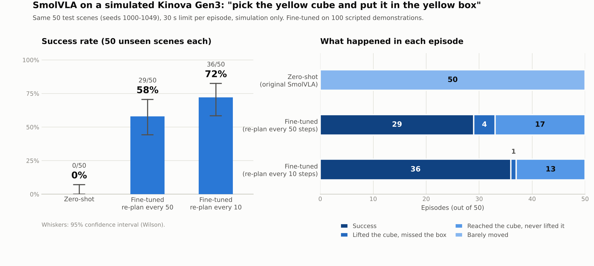

# Language-Guided Pick-and-Place with SmolVLA on a Simulated Kinova Gen3

Can the pretrained vision-language-action model **SmolVLA** (Hugging Face / LeRobot, ~450M params) follow
*"pick the yellow cube and put it in the yellow box"* on a simulated Kinova Gen3 arm?
Simulation only (MuJoCo), no real robot. Metrics: success rate and completion time.



## Results (50 unseen scenes, seeds 1000-1049, 30 s limit per episode)

| Policy | Success (95% CI) | Mean time (sim, successes only) | Main failure |
|---|---|---|---|
| Scripted teacher (upper bound) | 50/50 = 100% (93-100%) | 6.77 s | none |
| SmolVLA zero-shot (`smolvla_base`) | 0/50 = 0% (0-7%) | n/a | arm barely moved (50/50) |
| SmolVLA fine-tuned | 29/50 = 58% (44-71%) | 6.64 s | reached cube, never lifted it (17) |
| SmolVLA fine-tuned + re-plan every 10 steps | 36/50 = 72% (58-83%) | 7.85 s | reached cube, never lifted it (13) |

- Fine-tuning is the decisive factor (0% -> 58-72%, Fisher exact p < 1e-10).
- Re-planning every 10 steps vs 50 is not statistically significant at n = 50 (p = 0.21).
- Grasping is the bottleneck: in both fine-tuned runs the hand reached the cube in 50/50 episodes.
- Completion time is simulated time and excludes model inference latency (~0.5-0.65 s per action chunk).

## Stress test: mirrored layout
In training and in the main evaluation the cube always starts on the robot's right and the box on its left.
Mirroring the layout (cube left, box right, same 50 seeds, `SWAP_SIDES=1`) makes the fine-tuned model fail:

| Layout | Fine-tuned SmolVLA | Scripted teacher |
|---|---|---|
| Standard | 29/50 = 58% | 50/50 |
| Mirrored | 0/50 = 0% (0-7%) | 20/20 (checked on 20 seeds) |

43 of the 50 failures never reached the cube, so the 58-72% only holds for the training layout. The model learned the
motion of the training scenes, not "find the cube and the box". Next step: demonstrations with randomised sides.

## Pipeline
1. **Scene** - MuJoCo: Kinova Gen3 (7-DoF) + Robotiq 2F-85, table, yellow cube/box, front + wrist cameras.
2. **Adapter** (`vla_agent.py`) - maps the 7-DoF arm to SmolVLA's 6-number state/action interface.
3. **Zero-shot baseline** - `lerobot/smolvla_base`, 50 episodes.
4. **Demonstrations** - a scripted IK expert (damped least squares) records 100 demos (14,036 frames)
   as a LeRobotDataset; SmolVLA is fine-tuned for 10,000 steps (batch 8, ~2 h on an RTX 3050 Ti, 4 GB).
5. **Evaluation** - the same 50 held-out seeds for every policy, Wilson confidence intervals, failure-mode classification.

## Run it (Windows, Python 3.12)
```powershell
py -3.12 -m venv .venv
.venv\Scripts\activate
pip install torch --index-url https://download.pytorch.org/whl/cu128
pip install -r requirements.txt

python step1_check_scene.py                       # scene health check
python step2_check_smolvla.py                     # does SmolVLA load and give an action?
python watch_live.py                              # watch the scripted teacher in the MuJoCo window
python step3_baseline.py --episodes 50            # zero-shot baseline

python record_demos.py --episodes 100             # record demonstrations
python check_dataset.py
python step4_train.py --policy.path=lerobot/smolvla_base --policy.push_to_hub=false --policy.device=cuda --dataset.repo_id=local/gen3_pickplace --dataset.root=datasets/gen3_pickplace --dataset.video_backend=pyav --batch_size=8 --steps=10000 --log_freq=250 --save_freq=2500 --num_workers=0 --output_dir=outputs/train_gen3_v1 --job_name=gen3_v1 --wandb.enable=false

# evaluate the fine-tuned model on the same 50 scenes
python step3_baseline.py --episodes 50 --model-id outputs\train_gen3_v1\checkpoints\010000\pretrained_model
$env:SMOLVLA_REPLAN="10"; python step3_baseline.py --episodes 50 --model-id outputs\train_gen3_v1\checkpoints\010000\pretrained_model

# mirrored layout (cube left, box right); remove the variable afterwards
$env:SWAP_SIDES="1"; python step3_baseline.py --episodes 50 --model-id outputs\train_gen3_v1\checkpoints\010000\pretrained_model
Remove-Item Env:SWAP_SIDES

# scripted-teacher reference (prints "Done: X of 50 successful")
python watch_live.py --who teacher --seed 1000 --episodes 50 --speed 20 --pause 0 --no-cams --exit-when-done
```
The trained weights and the dataset are not in this repo (too large); the commands above recreate them.

## Files
```
pick_place_env.py      environment: reset(), step(), cameras, success check
vla_agent.py           SmolVLA wrapper + Gen3 <-> SO-100 adapter (SMOLVLA_REPLAN = re-plan interval)
expert_controller.py   scripted IK teacher
record_demos.py        records demonstrations in LeRobotDataset format
step1_* .. step4_*     scene check, SmolVLA check, baseline/evaluation (SWAP_SIDES = mirrored layout), training launcher
watch_live.py          live MuJoCo viewer with the robot's camera views
scene/                 MuJoCo XML + meshes (Menagerie licences included)
results/               final 50-episode summaries and per-episode CSVs (standard and mirrored layout), chart
```

## Limitations
- Simulation only; one prompt (no language-grounding test).
- Layout: the cube always starts on the robot's right and the box on its left; the model fails (0/50) when mirrored.
- 100 scripted demos without recovery behaviour; 50 evaluation episodes per policy.
- Results vary between runs for the same seed because SmolVLA samples its actions with random noise.

## Next steps
Demonstrations with randomised sides, a colour-instruction test (green vs yellow cube),
and a comparison with other small policies (Evo-1, ACT) on the same data and seeds.

## Credits
SmolVLA / LeRobot (Hugging Face), robot models from
[MuJoCo Menagerie](https://github.com/google-deepmind/mujoco_menagerie) (BSD-3-Clause, see `scene/`).